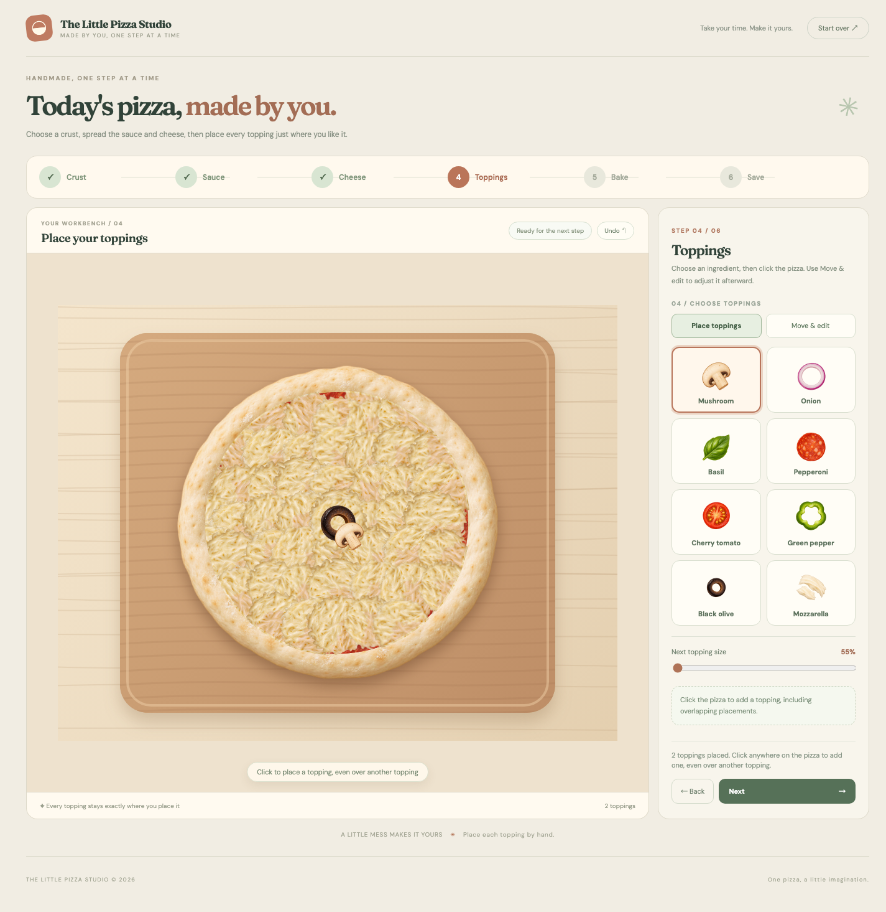

# The Little Pizza Studio

A small browser game about making a pizza one step at a time. It is designed for people who enjoy short, visual, creative activities. The goal is to finish a personal pizza and download an image of it.

The main interaction is direct: choose a crust, brush on sauce and cheese, and place toppings on the pizza. These actions change the picture immediately. Step instructions, status text, and the **Next** button tell the player what happened and what to do next.

## Play online

[Play The Little Pizza Studio](https://jingyichen888.github.io/the-little-pizza-studio/). The online game is published from `dist/` through GitHub Pages.

## Screenshot



## Run locally

From the repository root, run:

```sh
python3 -m http.server 8000 --directory dist
```

Open <http://localhost:8000> in a browser. Press `Ctrl+C` in the terminal to stop the server. The game needs no build step, package installation, or account.

## How to play

1. Choose a classic, thin, or whole wheat crust.
2. Choose tomato sauce, basil pesto, or cream sauce. Press and drag on the pizza to spread it.
3. Press and drag to scatter mozzarella.
4. In **Place toppings** mode, choose an ingredient and click the pizza. A click adds one item, even on top of another. Choose **Move & edit** to select, drag, resize, rotate, or remove an item.
5. Set a baking time from 6 to 12 minutes and select **Start baking**. Shorter times leave a lighter crust and cheese; longer times make both more toasted.
6. Enter a name and select **Download your pizza** to save a PNG.

Sauce and cheese appear where the player brushes. When the player moves forward, the game fills remaining gaps using the same texture and brush scale as the visible marks. Each of the three sauces has its own texture. Toppings stay at the positions the player chose.

**Next** stays disabled until the required action for a step is complete. For example, the player cannot leave the first step without choosing a crust. **Undo** reverses recent changes. Returning to the first **Crust** step clears the pizza and Undo history; **Start over** also resets the game after confirmation. Progress is saved in the current browser. If the name field is empty, the PNG is named **My Pizza**.

## Known limitations

- Progress uses browser local storage and does not sync between devices or browsers.
- Baking time changes the appearance of the finished pizza, but the animation lasts only a moment rather than the selected number of minutes.
- Google Fonts need a network connection. The game falls back to system fonts offline.

## Files and sources

- `dist/index.html`, `dist/style.css`, and `dist/app.js`: the playable game.
- `dist/assets/`: the crust, topping, sauce, cheese, and icon assets.
- `references/`: screenshots, visual references, and image-generation notes.
- `.github/workflows/deploy-pizza.yml`: publishes the game in `dist/` to GitHub Pages when `main` is updated.
- `PROCESS.md`: design iterations, the human tryout, and AI tool use.

The food images were made with the AI image tool ImageGen; their briefs are documented in [`references/asset-prompts.md`](references/asset-prompts.md). The interface loads [DM Sans](https://fonts.google.com/specimen/DM+Sans) and [Fraunces](https://fonts.google.com/specimen/Fraunces) from Google Fonts. The game code, interface text, and documentation were developed with the AI coding assistant Codex and revised through review and player feedback. All assets needed to play are included in this repository.
